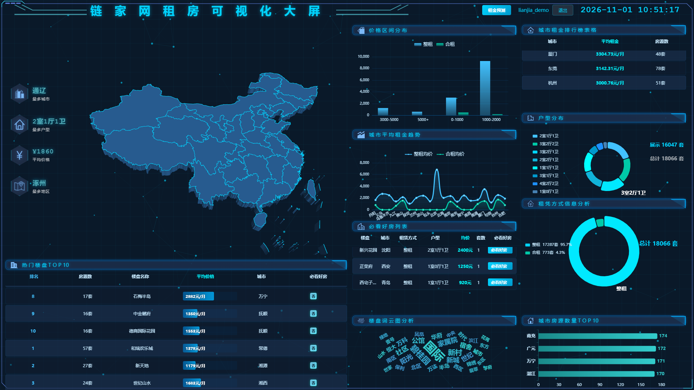

# 基于Spark的链家网租房数据分析与可视化系统

## 一、项目简介

本项目是一个完整的大数据分析系统，通过爬取链家网全国租房数据，利用Spark进行数据处理和分析，最终以可视化大屏的形式展示分析结果。

**技术栈：** Python + Spark + Hive + HDFS + MySQL + FastAPI + Vue + ECharts + Scikit-learn



---

## 二、系统架构

```
┌─────────────┐    ┌─────────────┐    ┌─────────────┐    ┌─────────────┐    ┌─────────────┐
│  数据采集层  │───▶│  数据存储层  │───▶│  数据处理层  │───▶│  数据分析层  │───▶│  数据展示层  │
│   Spider    │    │  HDFS+Hive  │    │  Spark      │    │ MySQL+ML    │    │ FastAPI+Vue │
└─────────────┘    └─────────────┘    └─────────────┘    └─────────────┘    └─────────────┘
```

### 数据流向
```
链家网 → 爬虫采集 → CSV → HDFS → Hive(ODS) → Spark(DWD清洗) → Spark(ADS分析) → MySQL → FastAPI API → Vue大屏
                                                                              ↓
                                                                          Spark ML训练 → 模型文件 → FastAPI预测API → Vue预测页面
```

---

## 三、目录结构

```
├── spider/                    # 爬虫模块
│   ├── spiderMain.py          # 主爬虫（DrissionPage + BeautifulSoup）
│   ├── spiderAddress.py       # 城市URL爬取
│   ├── house.csv              # 爬取的房源数据（约25000条）
│   └── address.csv            # 城市链家URL列表（142个城市）
│
├── spark/                     # Spark数据处理模块
│   ├── ODS.py                 # ODS层：CSV→Hive原始表
│   ├── DWD.py                 # DWD层：数据清洗（去重、空值处理、字段标准化）
│   ├── detailADS.py           # ADS层：省份区域分析（城市→省份映射）
│   └── data_scripts/          # 数据写入MySQL的脚本
│       ├── init.sql           # MySQL建表SQL（17张表）
│       ├── get_home_data.py   # 首页仪表盘数据
│       ├── get_detail_data.py # 省份详情数据
│       ├── cityRentRank.py    # 城市租金排行
│       ├── cityHouseCountTop10.py  # 城市房源数量TOP10
│       ├── price_distribution.py   # 价格区间分布
│       ├── rentTypeAnalysis.py     # 租赁方式分析
│       ├── houseTypeAnalysis.py    # 户型分布
│       ├── top10_buildings.py      # 热门楼盘TOP10
│       ├── featuredHouses.py       # 必看好房
│       ├── communityWordCloud.py   # 小区词云
│       ├── cityRentTrend.py        # 租金趋势
│       ├── generate_community_stats.py  # 小区统计
│       ├── generate_district_stats.py   # 区县统计
│       ├── generate_house_details.py    # 房源详情
│       ├── fetch_area_geo.py       # 区县经纬度（高德API）
│       └── fetch_community_geo.py  # 小区经纬度（高德API）
│   └── ml/                      # 机器学习模块
│       ├── train_rent_model.py  # 租金预测模型训练脚本
│       └── model/               # 模型文件（训练后生成）
│           ├── pipeline_model.pkl    # sklearn Pipeline（预处理+随机森林）
│           └── model_metadata.json   # 模型元数据
│
├── analysis/                  # FastAPI分析路由（/analysis/api）
│   ├── __init__.py            # 路由导出
│   ├── views.py               # 16个API接口（查MySQL + 模型预测）
│   ├── db.py                  # pymysql 连接与查询
│   ├── cache.py               # 接口TTL缓存（300秒）
│   └── model_loader.py        # 租金预测Pipeline加载（启动时预热）
│
├── users/                     # FastAPI用户路由（/users）
│   ├── __init__.py            # 路由导出
│   ├── views.py               # 注册/登录/用户信息
│   ├── models.py              # PyMySQL用户数据访问层（zufangdata库）
│   └── auth.py                # JWT签发与校验（PyJWT，Token前缀手工解析）
│
├── config.py                  # 全局配置（两个MySQL、JWT、端口、缓存时长）
├── app.py                     # FastAPI入口（路由挂载、CORS、建表、启动8000）
│
├── frontend/                  # Vue前端
│   ├── src/
│   │   ├── views/
│   │   │   ├── Home.vue       # 首页大屏（111KB，包含所有图表）
│   │   │   ├── CityDetail.vue # 省份详情页（45KB）
│   │   │   ├── Predict.vue    # 租金预测页
│   │   │   └── Login.vue      # 登录页
│   │   ├── router/index.js    # 路由配置
│   │   ├── utils/request.js   # Axios封装
│   │   └── components/
│   │       └── TechBackground.vue  # 粒子背景组件
│   └── package.json           # 前端依赖
│
├── requirements.txt           # Python依赖
└── 启动关闭指令.txt            # 服务器操作指南
```

---

## 四、数据仓库分层

### ODS层（原始数据层）
- **表名：** `ods_lianjia_house`
- **来源：** HDFS上的house.csv
- **说明：** 原始爬取数据，不做任何处理

### DWD层（数据清洗层）
- **表名：** `dwd_lianjia_house_clean`
- **处理逻辑：**
  - 去除完全重复的记录
  - 空值处理：`direction`和`tags`允许为空，其他字段不允许
  - 字段标准化：价格转数值、面积转数值、楼层类型标准化
  - 新增字段：`rent_type`（整租/合租）、`is_featured`（必看好房标识）

### ADS层（数据分析层）
- **表名：** `ads_province_district_analysis`
- **处理逻辑：**
  - 城市→省份映射（覆盖全国300+城市）
  - 按省份、区县聚合统计
  - 计算均价、最高价、平均面积等指标

---

## 五、MySQL数据表（共17张）

| 序号 | 表名 | 说明 |
|------|------|------|
| 1 | `home_dashboard` | 首页仪表盘汇总数据 |
| 2 | `province_rank` | 省份租房排名 |
| 3 | `city_rent_rank` | 城市租金排行 |
| 4 | `price_distribution` | 价格区间分布（含整租/合租） |
| 5 | `house_type_analysis` | 户型分布 |
| 6 | `rent_type_analysis` | 租赁方式分析 |
| 7 | `top10_buildings` | 热门楼盘TOP10 |
| 8 | `featured_houses` | 必看好房列表 |
| 9 | `community_wordcloud` | 小区词云数据 |
| 10 | `city_house_count_top10` | 城市房源数量TOP10 |
| 11 | `city_rent_trend` | 城市租金趋势 |
| 12 | `province_details` | 省份详情（含区县、价格/面积/租赁分布JSON） |
| 13 | `district_price_count` | 区县价格统计 |
| 14 | `community_stats` | 小区统计（房源数、均价） |
| 15 | `area_geo` | 区县经纬度（高德API） |
| 16 | `community_geo` | 小区经纬度（高德API） |
| 17 | `house_details` | 房源详情列表 |

---

## 六、API接口列表

| 接口 | 方法 | 说明 |
|------|------|------|
| `/analysis/api/home-data/` | GET | 首页仪表盘数据 |
| `/analysis/api/province-data/?province=四川省` | GET | 省份详情数据 |
| `/analysis/api/city-district-detail/?city=成都` | GET | 城市区县详情 |
| `/analysis/api/community-detail/?city=成都&district=武侯` | GET | 小区经纬度+统计 |
| `/analysis/api/house-details/?city=成都&district=武侯&community=xxx` | GET | 房源列表 |
| `/analysis/api/top10-buildings/` | GET | 热门楼盘TOP10 |
| `/analysis/api/price-distribution/` | GET | 价格区间分布 |
| `/analysis/api/city-rent-rank/` | GET | 城市租金排行 |
| `/analysis/api/city-rent-trend/` | GET | 城市租金趋势 |
| `/analysis/api/house-type-distribution/` | GET | 户型分布 |
| `/analysis/api/featured-houses/` | GET | 必看好房 |
| `/analysis/api/rent-type-analysis/` | GET | 租赁方式分析 |
| `/analysis/api/community-wordcloud/` | GET | 小区词云 |
| `/analysis/api/city-house-count-top10/` | GET | 城市房源TOP10 |
| `/analysis/api/rent-predict/` | POST | 租金价格预测 |
| `/analysis/api/rent-model-info/` | GET | 模型信息和可选项 |
| `/users/api/register/` | POST | 用户注册 |
| `/users/api/login/` | POST | 用户登录 |

---

## 七、前端页面说明

### 1. 登录页（Login.vue）
- 用户名/密码登录
- JWT Token认证
- 登录后跳转到大屏首页

### 2. 首页大屏（Home.vue）
- **顶部指标卡：** 租房城市TOP、户型TOP、平均价格、区县TOP
- **左侧：** 省份租房排名（地图）、租房排行榜（滚动）
- **中间：** 全国地图（点击省份查看详情）、价格区间分布、租赁方式饼图
- **右侧：** 户型分布、城市房源TOP10（滚动）、必看好房列表（滚动）、小区词云
- **底部：** 租金趋势折线图、热门楼盘TOP10

### 3. 省份详情页（CityDetail.vue）
- **地图：** 区县气泡图（显示房源数和均价）
- **左侧：** 区县房源分布、区县均价对比
- **右侧：** 价格分布、面积分布、租赁方式分布、最高价TOP5
- **底部：** 点击区县→显示小区气泡→点击小区→显示房源列表

### 4. 租金预测页（Predict.vue）
- **输入：** 城市、区县、户型、面积、朝向、楼层类型、租赁方式
- **算法：** 随机森林回归（scikit-learn）
- **特征：** 城市、区县、户型、面积、朝向、楼层类型、租赁方式（共7个）
- **输出：** 预测租金价格（元/月）
- **入口：** 大屏右上角"租金预测"按钮

---

## 八、环境要求

### 服务器环境（虚拟机）
- **操作系统：** Linux
- **Hadoop：** HDFS + YARN
- **Spark：** 2.x/3.x
- **Hive：** Metastore + MySQL元数据库
- **MySQL：** 5.7+（utf8mb4编码）
- **Python：** 3.8+
- **scikit-learn：** 随机森林回归模型

### 本地开发环境
- **Python：** 3.8+
- **Node.js：** 14+
- **Vue CLI：** 5.0

---

## 九、部署启动

### 1. 虚拟机端（数据处理）
```bash
# 首次运行：初始化MySQL表
mysql -u root -p123456 < /mnt/pycharm/spark/data_scripts/init.sql

# 首次运行：上传数据到HDFS
cd /mnt/pycharm/spider
hdfs dfs -put -f house.csv /data/lianjia/

# 运行Spark数据处理管道
cd /mnt/pycharm/spark
spark-submit --jars /opt/software/hive/lib/mysql-connector-java-5.1.49-bin.jar \
  --files /opt/software/hive/conf/hive-site.xml ODS.py
spark-submit --jars /opt/software/hive/lib/mysql-connector-java-5.1.49-bin.jar \
  --files /opt/software/hive/conf/hive-site.xml DWD.py
spark-submit --jars /opt/software/hive/lib/mysql-connector-java-5.1.49-bin.jar \
  --files /opt/software/hive/conf/hive-site.xml detailADS.py

# 运行数据写入MySQL脚本
cd /mnt/pycharm/spark/data_scripts
spark-submit --jars /opt/software/hive/lib/mysql-connector-java-5.1.49-bin.jar \
  --files /opt/software/hive/conf/hive-site.xml get_home_data.py
# ... 其他脚本类似

# 安装机器学习依赖（首次执行）
pip install "pandas<2.3" scikit-learn joblib

# 训练租金预测模型
spark-submit --jars /opt/software/hive/lib/mysql-connector-java-5.1.49-bin.jar \
  --files /opt/software/hive/conf/hive-site.xml \
  /mnt/pycharm/spark/ml/train_rent_model.py
```

### 2. 后端启动（FastAPI）
```bash
cd 基于spark的链家网租房数据分析与可视化系统

# 环境必须用 conda datacol（含 FastAPI / scikit-learn / joblib）
conda activate datacol
pip install -r requirements.txt

# 启动（端口固定 8000，与前端 request.js 一致）
python app.py

# 预期输出：
#   ✓ 租金预测模型加载成功
#   后端启动: http://0.0.0.0:8000  (FastAPI + Uvicorn)
#   Uvicorn running on http://0.0.0.0:8000
```

> 无数据库迁移步骤：用户表在启动时幂等创建（`CREATE TABLE IF NOT EXISTS`）。
> 框架默认不开启热重载，改后端代码后需手动重启。

### 3. 前端启动
```bash
cd frontend
npm install
npm run dev
```

### 4. 一键启动/关闭
```bash
# 启动
/root/start_project.sh

# 关闭
/root/stop_project.sh
```

---

## 十、关键配置

### 环境变量（.env）
密码等敏感凭据**不入代码库**：首次使用请把 `.env.example` 复制为 `.env` 并填写真实值，`config.py` 启动时自动加载，缺项会直接报错提示缺失的变量名。
`.env` 已被 `.gitignore` 排除，不会随代码上传。

### 主要配置项（config.py）
```python
BUSINESS_DB_HOST / BUSINESS_DB_PASSWORD  # 业务库（虚拟机，17 张分析表）— 来自 .env
USER_DB_HOST / USER_DB_PASSWORD          # 用户库（本机）— 来自 .env
JWT_SECRET_KEY                           # JWT 签名密钥 — 来自 .env
JWT_HEADER_TYPE = "Token"                # 前端携带格式为 Authorization: Token xxx
PORT = 8000                              # 可用环境变量 API_PORT 覆盖，与 frontend/src/utils/request.js 的 baseURL 保持一致
CACHE_TTL = 300                          # 接口缓存时长（秒）
```

### 高德API（经纬度获取）
- 用于获取区县和小区的经纬度坐标
- 脚本：`fetch_area_geo.py`、`fetch_community_geo.py`

### 前端请求地址（frontend/src/utils/request.js）
- 直连后端 `http://127.0.0.1:8000`（跨域由 FastAPI CORSMiddleware 放行）
- `vite.config.js` 中的 `/analysis`、`/users` 代理为备用通道，正常情况下不会被使用

---

## 十一、数据规模

- **爬取城市：** 142个
- **原始数据：** 约25,000条房源记录
- **清洗后数据：** 约18,000条有效记录
- **覆盖省份：** 31个省级行政区
- **数据字段：** 城市、区县、小区、户型、面积、价格、朝向、楼层、标签等
- **模型训练：** 80%训练集 + 20%测试集，随机森林回归（100棵树）

---

## 十二、注意事项

1. **DWD.py必须最先运行**，其他Spark脚本依赖清洗后的数据
2. **高德API有调用限制**，经纬度获取脚本运行较慢
3. **MySQL编码必须是utf8mb4**，否则中文会乱码
4. **Spark脚本使用 `mode("overwrite")`**，每次运行会覆盖旧数据
5. **前端使用Vue 3 + ECharts 5**，大屏适配1920x1080分辨率
6. **模型训练需要安装依赖**：`pip install "pandas<2.3" scikit-learn joblib`
7. **模型训练后会生成3个文件**在 `spark/ml/model/` 目录下，后端启动时自动加载
8. **预测页面入口：** 大屏右上角"租金预测"按钮
9. **虚拟机必须开机**：业务数据在 `192.168.80.138` 的 MySQL，连不上则所有分析接口返回 500
10. **后端必须跑在 8000 端口**：`request.js` 写死了 `http://127.0.0.1:8000`，改端口需同步修改前端
11. **改后端代码后需手动重启** `python app.py`：Uvicorn 默认关闭热重载（`reload=False`），不会自动重载
